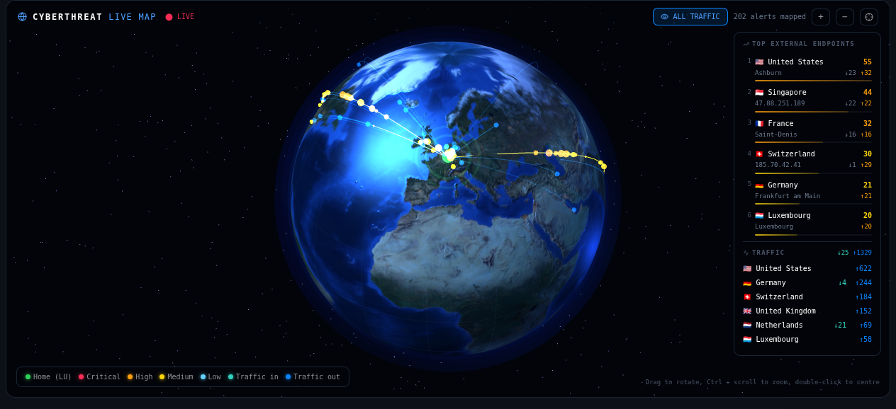
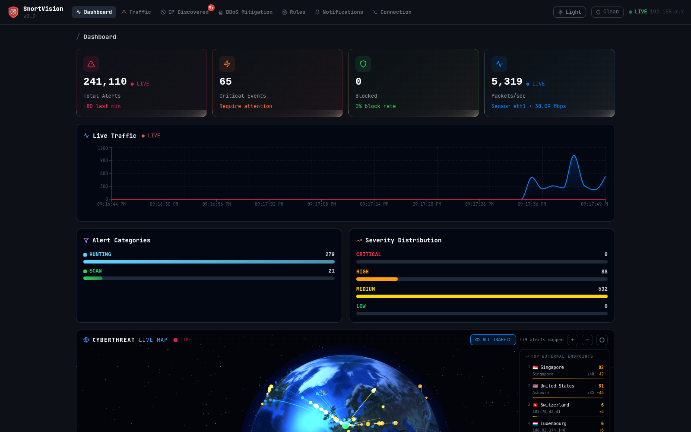
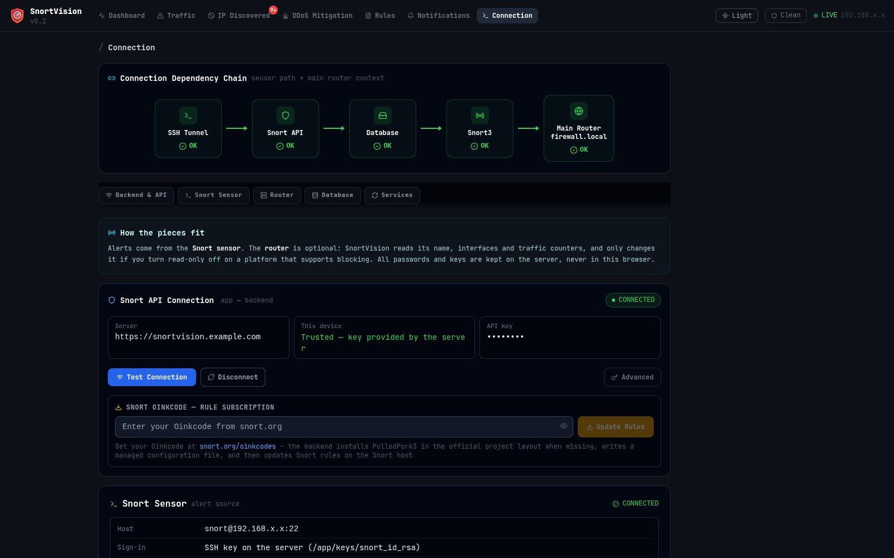
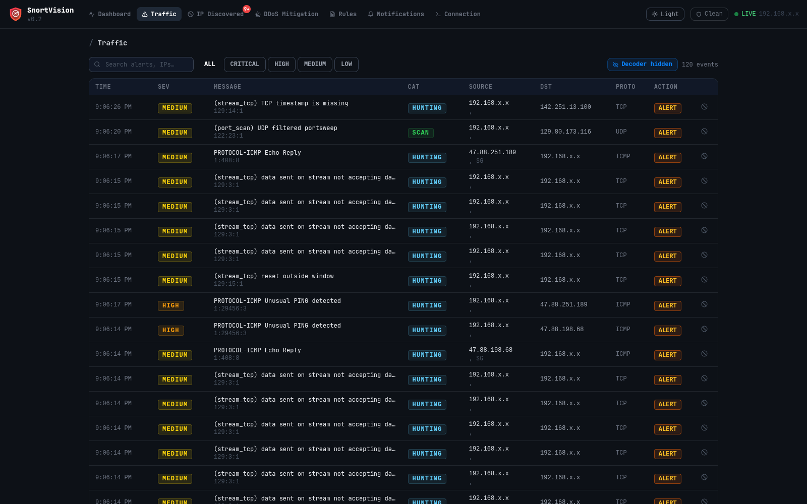
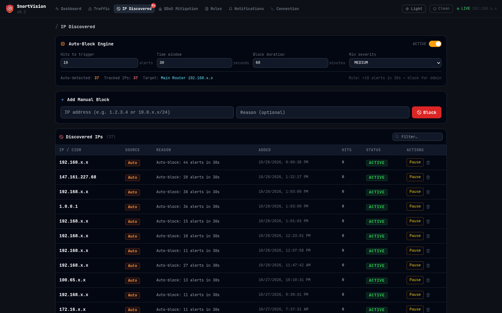
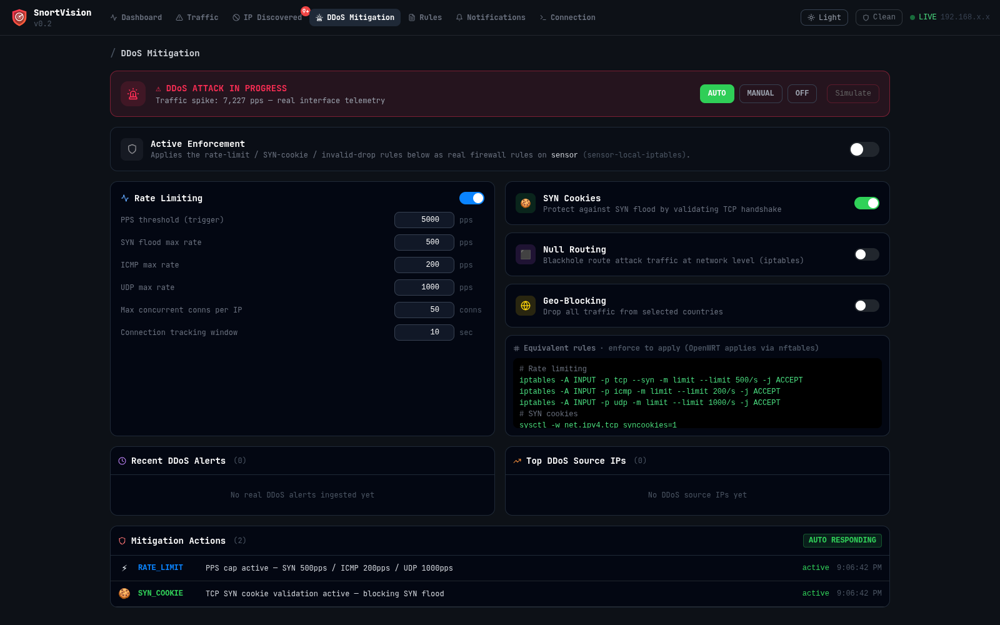
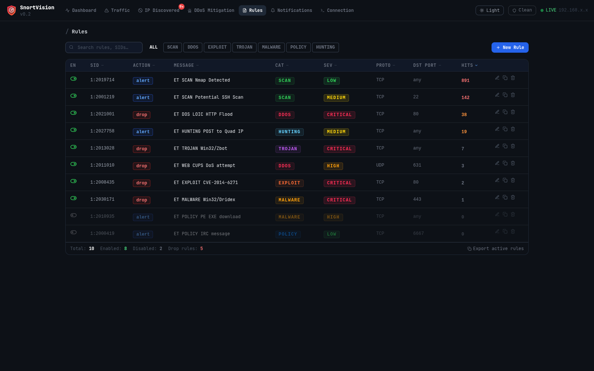
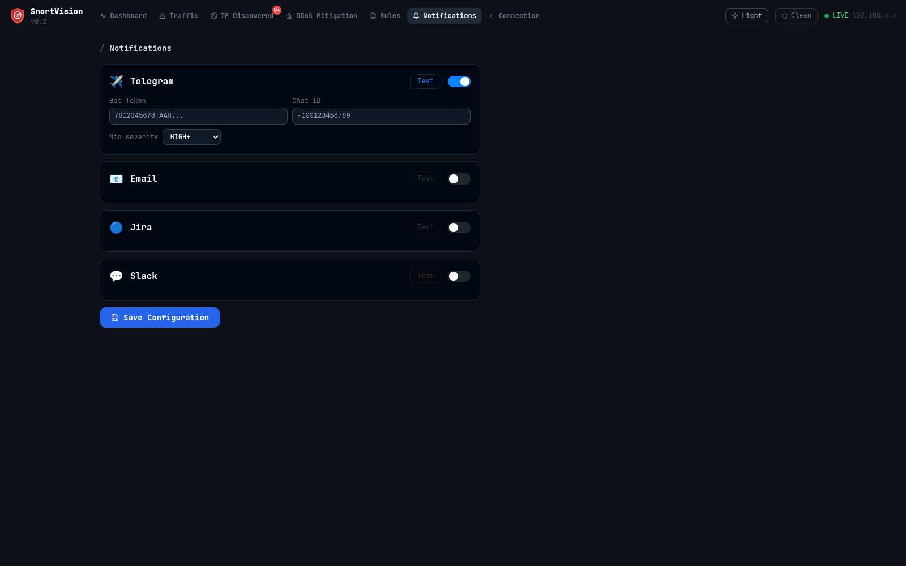
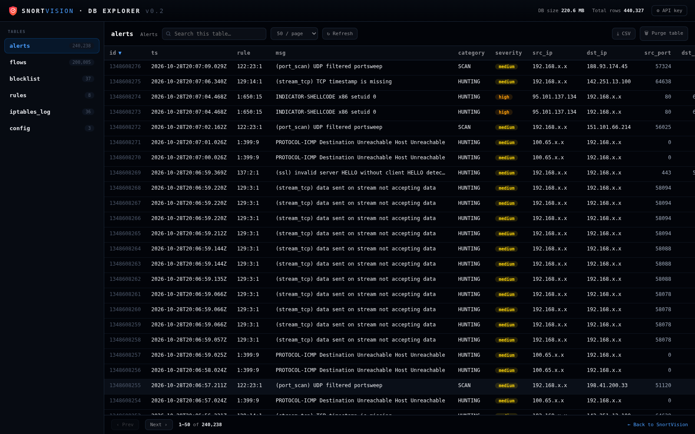
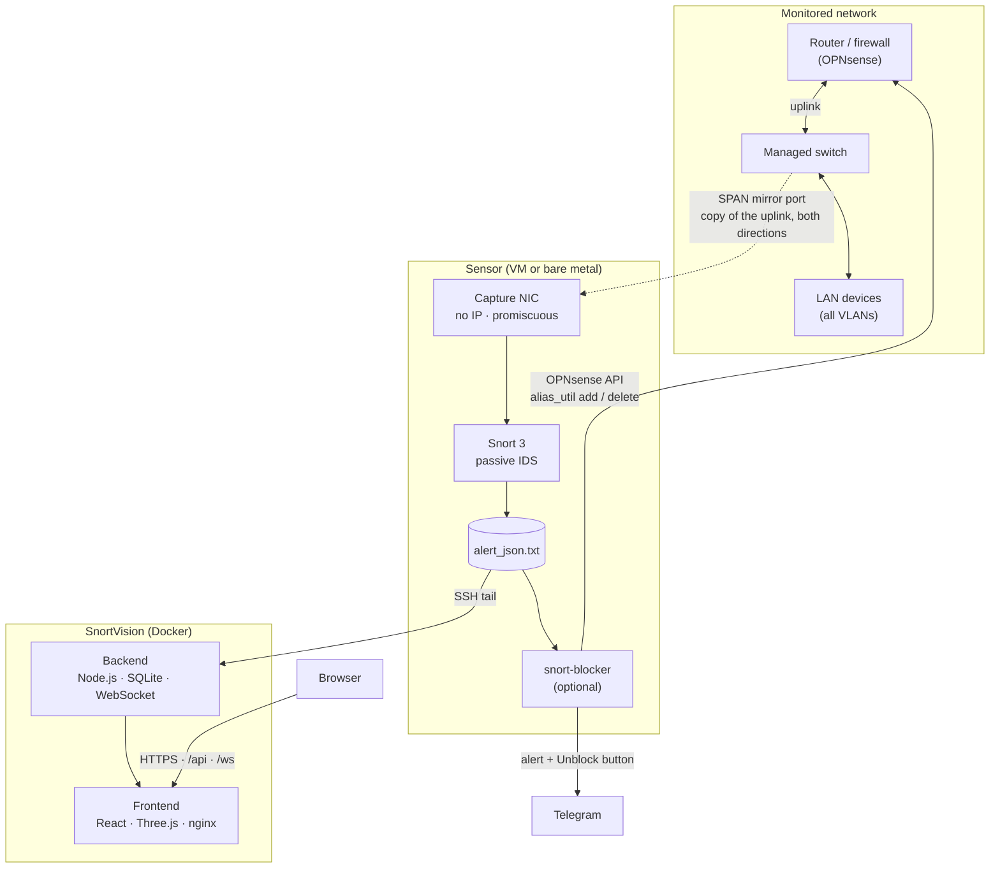

# 🛡️ SnortVision v0.2

<p align="center">
  <b>Passive network IDS dashboard for Snort 3: the switch mirrors your LAN to a sensor, Snort inspects every packet, SnortVision shows it live on a 3D globe and can push blocks to your firewall.</b>
</p>

<p align="center">
  
  
  
  
  
  
  
  
</p>

<p align="center">
  
</p>

---

## Contents

- [What it does](#what-it-does)
- [Screenshots](#screenshots)
- [How it works](#how-it-works)
- [What's new in v0.2](#whats-new-in-v02)
- [Data retention: 10 days, 4 million alerts](#data-retention-10-days-4-million-alerts)
- [Installation](#installation)
- [Configuration reference](#configuration-reference)
- [Security model](#security-model)
- [Technology stack](#technology-stack)
- [Roadmap](#roadmap)
- [Author](#author)

---

## What it does

SnortVision turns a **Snort 3** sensor into a live security operations view for a home lab or a small office network:

- **Sees everything, touches nothing.** A managed switch copies the router uplink to a mirror (SPAN) port. The sensor only listens: it has no IP address on that port and cannot be reached or bypassed from the monitored network.
- **Shows it live.** Alerts and flows are streamed into SQLite and pushed to the browser over WebSocket: counters, live traffic, categories, severities and a 3D globe with traffic and attacks per country.
- **Acts on the firewall.** The optional `snort-blocker` service reads the same alert feed and places offenders in **OPNsense** aliases: home devices go to quarantine, external hosts are blocked, both for 24 h, with a Telegram alert and an *Unblock* button.
- **Keeps history.** **10 days of alerts** by default, with a safety cap of **4,000,000 alerts**, browsable in the built-in DB explorer.

---

## Screenshots

### Dashboard
Live counters, packets per second from the capture NIC, alert categories and severity distribution, updated in real time.

<p align="center"></p>

### Cyberthreat live map
Traffic and attacks per country on a 3D globe: arcs follow the direction of each connection, inbound attacks hit home with an impact ring, and the side panel ranks the top external endpoints and the traffic in/out per country.

<p align="center"></p>

### Connection
The whole chain at a glance (SSH tunnel → API → database → Snort → router). Trusted devices connect on their own, and every password and key stays on the server.

<p align="center"></p>

### More views

<table>
  <tr>
    <td width="50%"><br><b>Traffic</b>: live alert and flow feed with severity and protocol filters.</td>
    <td width="50%"><br><b>IP Discovered</b>: hit counts, severity, auto-block engine and manual blocks.</td>
  </tr>
  <tr>
    <td width="50%"><br><b>DDoS Mitigation</b>: detection thresholds, AUTO / MANUAL / OFF modes, generated rules.</td>
    <td width="50%"><br><b>Rules</b>: manage and deploy Snort rules, Oinkcode subscription updates.</td>
  </tr>
  <tr>
    <td width="50%"><br><b>Notifications</b>: Telegram, Email, Jira and Slack, each with a test button.</td>
    <td width="50%"><br><b>DB explorer</b> (<code>/db</code>): browse, search, export to CSV and purge every table.</td>
  </tr>
</table>

> All screenshots come from a live installation watching real traffic. Internal addresses and hostnames are masked.

---

## How it works



1. **Mirror.** The core switch copies every frame of the router uplink (`both` directions) to a dedicated mirror port. Because the uplink carries all VLANs, the sensor sees traffic between every VLAN and the Internet, and between VLANs routed by the firewall.
2. **Capture.** The mirror port is cabled to a NIC on the sensor that has **no IP address**. On Proxmox it is a separate bridge with MAC learning disabled, so the bridge behaves like a hub and hands every mirrored frame to the Snort VM. GRO/LRO are off so Snort sees real packets, not merged super-frames.
3. **Detect.** Snort 3 runs in passive mode on that interface (`-i <capture-nic> -A alert_json`) and writes one JSON line per alert to `/var/log/snort/alert_json.txt`.
4. **Store and show.** The SnortVision backend follows that file over SSH (GNU `tail -F`), parses each line, enriches it with GeoIP and stores it in SQLite. The frontend polls the REST API and receives new events over WebSocket.
5. **Respond.** `snort-blocker` follows the same file on the sensor. For priority-1 alerts it calls the OPNsense API (`alias_util`) to add the address to a firewall alias; firewall rules on those aliases do the actual blocking. Entries expire on their own after 24 h.

The two paths are independent: the dashboard keeps working if the firewall integration is off, and blocking keeps working if the dashboard is down.

---

## What's new in v0.2

### 🌍 Live map, rebuilt
- Globe framed on the home location, arcs whose height follows distance and that never leave the canvas.
- **Direction-aware**: outbound alerts (internal → external, e.g. C2 traffic) are drawn from home outwards; impact rings only for inbound attacks.
- **Traffic per country, in and out**: arcs grouped per place and direction, brightness follows the connection count, every country drawn (no more 90-arc cap hiding whole countries).
- New endpoints panel: full country names, top city, in/out counts, worst severity seen, plus a *Traffic* section with connections per country.
- Realistic Earth: land and sea told apart, relief from a bump map, glossy sea and matte land, faint city lights, key and rim lighting.
- Zoom with **Ctrl + wheel** / pinch or the `+` / `−` buttons, re-centre button and double-click; `prefers-reduced-motion` respected.
- Multicast, broadcast and CGNAT addresses are no longer treated as public.

### 🔥 Firewall integration: `snort-blocker` (OPNsense)
- Snort priority-1 alerts → home device to a **quarantine** alias, external peer to a **block** alias, through the OPNsense API, for 24 h.
- Your networks come from the environment (`HOME_NETS`, `NEVER_BLOCK_NETS`, `GATEWAYS`); Cloudflare, public DNS and Telegram are always protected, and protected names are resolved at start and every hour.
- Per-list hourly limits, and a separate low cap for alerts without a TCP session (UDP/ICMP sources can be forged).
- Router certificate pinned; a block is only logged as applied when the router confirms it.
- Telegram alert for every real block with an **Unblock** button (only from the configured chat), 24 h pardon after an unblock, hourly summary when there are many.
- `DRY_RUN=1` by default: it only logs what it would do until you switch it on.

### 🔐 Connection page and trusted devices
- Devices listed in `SV_TRUSTED_NETS` get the API key from the server and connect on their own; others enter it under *Advanced*.
- The real client IP is taken from `X-Forwarded-For` past your own proxies (`SV_PROXY_IPS`) only; no proxy list means nobody is trusted.
- Sensor and router settings live on the server. Passwords, API keys and the Oinkcode are no longer stored in the browser; the API returns `hasPassword` / `hasApiKey` flags instead of secrets.
- Router platforms: **OPNsense** (REST API, key pair, certificate pinned on first use), **pfSense** (SSH), **OpenWrt** and **Linux**. **Read-only by default.**
- Database panel shows the real SQLite store: alerts, retention days, oldest alert, size and safety cap.

### 🗄️ Database and reliability
- **Alerts kept for 10 days by age**, with a **4,000,000-alert** safety cap for storms; pruning runs in batches until both limits are met.
- **No more duplicated alerts**: a replaced SSH tail no longer reconnects on its own (alerts were being stored up to 4 times), and GNU `tail` is used when present (the Rust `uutils tail` shipped by Ubuntu 26.04 replays the whole file on a PTY).
- Backend saturation fixed: time windows now compare ISO timestamps with ISO timestamps (a mismatch made every "last N seconds" query scan the whole table), new indexes, totals cached.
- SSH tail drops NUL bytes and caps unterminated lines (after `logrotate copytruncate` Snort can write a hole of zeros).
- Flows feed starts from the newest flows instead of crawling months of history.
- New **DB explorer** at `/db`, and nginx in the frontend container proxies `/api` and `/ws` to the backend.

The full list is in [CHANGELOG.md](CHANGELOG.md).

---

## Data retention: 10 days, 4 million alerts

| Setting | Default | Meaning |
|---|---|---|
| `ALERT_RETENTION_DAYS` | **10** | Alerts older than this are deleted, in batches, every minute. |
| `MAX_ALERTS` | **4,000,000** | Safety cap only. If an alert storm pushes the table past it, the oldest rows go first. |

- Retention works **by age first**: in normal operation you always have the last 10 days.
- The 4 million cap protects the disk during an attack or a misconfigured rule, whatever the retention says.
- Current values, oldest and newest alert and file size are shown on the Connection page and at `GET /api/db/stats`.
- Snort's own `alert_json.txt` is rotated separately by logrotate on the sensor; SnortVision does not depend on those files once alerts are stored.

---

## Installation

### Requirements

| Component | Minimum |
|---|---|
| Managed switch | Port mirroring (SPAN), one free port for the sensor |
| Sensor | Linux with Snort 3, a **dedicated NIC** for capture (2nd NIC on a VM is fine) |
| SnortVision host | Docker + Docker Compose (can be the sensor itself) |
| Firewall (optional) | OPNsense with API access, for automatic blocking |

### 1. Mirror the LAN on the switch

Mirror the port that connects the switch to the router/firewall, in **both** directions, to a free port. Example for TP-Link JetStream / Omada CLI (port 1 = uplink to the router, port 24 = sensor):

```text
configure
interface gigabitEthernet 1/0/24
  description SPAN-to-snort-sensor
exit
monitor session 1 destination interface gigabitEthernet 1/0/24
monitor session 1 source interface gigabitEthernet 1/0/1 both
end
show monitor session 1
```

Other vendors call it *port mirroring* or *SPAN*; the idea is the same. Cable the destination port to the sensor's capture NIC.

### 2. Prepare the capture interface on the sensor

The capture NIC must have **no IP address** and must hand every frame to Snort.

**Proxmox host** (sensor is a VM), in `/etc/network/interfaces`:

```text
auto vmbr2
iface vmbr2 inet manual
        bridge-ports enp2s0        # NIC cabled to the mirror port
        bridge-stp off
        bridge-fd 0
        bridge-ageing 0            # no MAC learning: behave like a hub
        post-up ethtool -K enp2s0 gro off lro off rxvlan off
```

Give the Snort VM a second network card on `vmbr2` with the Proxmox firewall **off** for that card. Inside the VM the card (e.g. `eth1`) stays without an IP.

**Bare metal**: bring the NIC up without an address and disable offloading:

```bash
ip link set eth1 up promisc on
ethtool -K eth1 gro off lro off
```

### 3. Install and run Snort 3

Install Snort 3 and the DAQ library (see `Snort3_SnortVision_Installation_Guide_FIXED.docx` in this repository, and `scripts/install_pulledpork3_official.sh` for rule updates). Then enable JSON alerts in `snort.lua`:

```lua
alert_json =
{
    file = true,
    fields = 'timestamp pkt_num proto src_addr src_port dst_addr dst_port src_ap dst_ap vlan dir rule gid sid rev action msg class priority'
}
```

Run it passively on the capture NIC, for example as a systemd service:

```ini
ExecStart=/usr/local/bin/snort -c /usr/local/etc/snort/snort.lua \
    --daq-dir /usr/local/lib/daq -i eth1 -s 65535 \
    -A alert_json -l /var/log/snort -u snort -g snort -m 0x1b
```

Check that alerts arrive: `tail -f /var/log/snort/alert_json.txt`.

> On Ubuntu 26.04, install the `gnu-coreutils` package on the sensor: it provides `gnutail`, which SnortVision uses automatically. The default Rust `tail` replays the whole log over SSH.

### 4. Deploy SnortVision

```bash
git clone https://github.com/marcopoveiro/snortvision.git
cd snortvision
cp .env.example .env            # then edit it, see the reference below

# SSH key the backend uses to read the alert log on the sensor
ssh-keygen -t ed25519 -f keys/snort_id_rsa -N ""
ssh-copy-id -i keys/snort_id_rsa.pub snort@<sensor-ip>

docker compose up -d --build
```

Open `http://<host>:3000`. If `API_KEY` is empty, the backend generates one on first start and writes it to `.env`.

### 5. Reverse proxy and trusted devices (recommended)

Put SnortVision behind HTTPS (nginx, Nginx Proxy Manager, Caddy…) and point the proxy at the **frontend** container: its nginx already forwards `/api` and `/ws` to the backend. WebSocket upgrade must be allowed for `/ws`.

Then list your own devices so they connect without typing the key:

```bash
SV_PROXY_IPS=172.18.0.0/16,<proxy-ip>          # compose network + your proxy
SV_TRUSTED_NETS=<admin-laptop-ip>,<phone-ip>     # fixed DHCP reservations work best
BACKEND_URL=https://snortvision.example.com
CORS_ORIGIN=https://snortvision.example.com
```

> Trust is per IP address. Give trusted phones a DHCP reservation and turn off per-network MAC randomisation, or they will drop to "offline" when their address changes.

### 6. Send blocks to the firewall (optional, OPNsense)

`scripts/snort-blocker.py` runs on the sensor as a systemd service and talks to the OPNsense API.

1. **On OPNsense**
   - Create two aliases of type **External (advanced)**: `SNORT_QUARANTINE` (home devices) and `SNORT_BLOCK` (external hosts). Only the API fills them, and their contents survive filter reloads. Other names can be set with `QUARANTINE_ALIAS` and `BLOCK_ALIAS`.
   - On each **home/user VLAN** interface add, at the top: *pass* `SNORT_QUARANTINE` → firewall DNS (so the device stays visible), *block* source `SNORT_QUARANTINE` → any, and *block* any → destination `SNORT_BLOCK`, all with logging. Leave management and server networks out.
   - Create an API user whose only privilege is **Diagnostics: PF Table IP addresses** (used by `alias_util`) and download its key file.
2. **On the sensor** (the service expects the repository in `/opt/snortvision` and a `snort` user)
   ```bash
   sudo git clone https://github.com/marcopoveiro/snortvision.git /opt/snortvision
   sudo install -d -o snort /etc/snort-blocker /var/lib/snort-blocker /var/log/snort-blocker
   sudo cp apikey.txt /etc/snort-blocker/opnsense.key           # key=… / secret=…
   openssl s_client -connect <router-ip>:443 </dev/null 2>/dev/null \
     | openssl x509 | sudo tee /etc/snort-blocker/router.pem    # pin the router certificate
   sudo cp /opt/snortvision/scripts/snort-blocker.service /etc/systemd/system/
   sudo systemctl daemon-reload && sudo systemctl enable --now snort-blocker
   ```
3. **Describe your networks** in a drop-in (`sudo systemctl edit snort-blocker`):
   ```ini
   [Service]
   Environment=HOME_NETS=192.168.10.0/24,192.168.11.0/24   # devices that may be quarantined
   Environment=NEVER_BLOCK_NETS=192.168.1.0/24,192.168.10.5/32    # never blocked: management, servers, admin PC
   Environment=GATEWAYS=192.168.1.1                          # extra gateways (the .1 of each home network is automatic)
   ```
   Only public addresses are ever blocked, and only devices inside `HOME_NETS` can be quarantined. With no `HOME_NETS` there are no quarantines.
4. **Dry run first.** The service starts with `DRY_RUN=1` and only writes what it *would* do to `/var/log/snort-blocker/actions.log`. When the log looks right, add `Environment=DRY_RUN=0` to the same drop-in and restart the service.
5. **Telegram (optional).** Create `/etc/snort-blocker/telegram.env` with `TELEGRAM_TOKEN=` and `CHAT_ID=` to receive every block with an *Unblock* button. If the bot is already used by another program, set `POLL_UPDATES=0` and `BRIDGE_KEY` (32+ characters), `BRIDGE_ORIGINS` and `BRIDGE_LISTEN`: that program then forwards the button taps to `POST /unblock`, signed with HMAC-SHA256.

Useful variables: `PROTECTED_NAMES` (hostnames never blocked, default `api.telegram.org`), `BLOCK_HOURS` (block duration, 24), `MAX_PER_HOUR_QUARANTINE` (10/h), `MAX_PER_HOUR_BLOCK` (200/h), `MAX_PER_HOUR_SESSIONLESS` (10/h), `IGNORE_SIDS` (`gid:sid` false positives to skip), `PARDON_HOURS` (pardon after unblock, 24).

---

## Configuration reference

All settings live in `.env` (see `.env.example`).

| Variable | Default | Purpose |
|---|---|---|
| `FRONTEND_PORT` / `BACKEND_PORT` | `3000` / `4000` | Published ports |
| `SNORT_HOST`, `SNORT_SSH_PORT`, `SNORT_SSH_USER` | – / `22` / `snort` | Sensor reached over SSH |
| `SNORT_LOG_PATH` | `/var/log/snort/alert_json.txt` | Alert file to follow |
| `SENSOR_INTERFACE` | – | Capture NIC, for packet/byte counters |
| `API_KEY` | generated | Key required by the API |
| `SV_TRUSTED_NETS` | – | IPs/CIDRs that receive the key automatically |
| `SV_PROXY_IPS` | – | Your reverse proxies (for the real client IP) |
| `ALERT_RETENTION_DAYS` | **`10`** | Alert retention by age |
| `MAX_ALERTS` | **`4000000`** | Safety cap on stored alerts |
| `GEOIP_ENABLE` | `false` | Offline GeoIP (online lookup is always used for the map) |
| `DDOS_PACKET_PPS_THRESHOLD` / `DDOS_ALERT_RATE_THRESHOLD` | `8000` / `20` | DDoS detection thresholds |
| `TELEGRAM_*`, `EMAIL_*`, `SLACK_*` | – | Notification channels |
| `BACKEND_URL`, `CORS_ORIGIN` | – | Public URL when behind a reverse proxy |

### Useful API calls

```bash
curl -H "X-API-Key: $KEY" https://snortvision.example.com/api/db/stats     # retention, size, oldest/newest
curl -H "X-API-Key: $KEY" -X DELETE "https://snortvision.example.com/api/alerts?days=30"
```

---

## Security model

- The sensor's capture NIC has no IP: the IDS cannot be reached from the network it watches.
- Router access is **read-only by default**; changes only happen when you turn read-only off on a platform that supports it.
- Secrets (SSH passwords, router keys, Oinkcode) stay on the server and are never sent back to the browser.
- OPNsense API calls go over a socket whose certificate is checked against the pinned one **before** the key pair is sent.
- Interface names are validated before reaching router shell commands.
- `snort-blocker` has hard limits per hour, protected networks and names, a dry-run mode and a 24 h expiry on every entry.

---

## Technology stack

| Layer | Technology |
|---|---|
| IDS engine | Snort 3 (passive sensor, JSON alerts) |
| Traffic capture | Switch SPAN port, dedicated NIC / Proxmox bridge |
| Backend | Node.js, Express, WebSocket (`ws`), `ssh2` |
| Database | SQLite (`better-sqlite3`), 10-day retention, 4M-alert cap |
| Frontend | React 18, Three.js, Recharts, Tailwind CSS, nginx |
| Firewall integration | Python 3, OPNsense API (`alias_util`), Telegram Bot API |
| Deployment | Docker, Docker Compose, systemd |

---

## Roadmap

- Light theme screenshots and a public demo dataset
- Blocking for pfSense and OpenWrt from the dashboard
- Configurable network lists for `snort-blocker` through the environment
- Per-rule statistics and suppression management from the Rules page

---

## Author

**Marco Mata** ([@marcopoveiro](https://github.com/marcopoveiro)) · Luxembourg
[LinkedIn](https://linkedin.com/in/marco-mata-lux)

## License

MIT: free to use, fork and contribute.

<p align="center">
  <i>Built in Luxembourg · Running 24/7 on a home lab · Watching real traffic</i>
</p>
